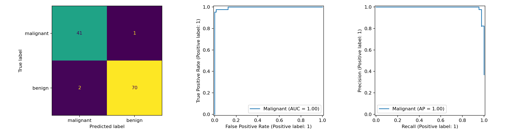

# Kết quả thực nghiệm Dự án 2

Sinh viên: Trần Duy Phúc – 24CKDL

Dữ liệu: 569 mẫu, 30 đặc trưng; train=455, test=114.
Tham số tốt nhất: {'svc__C': 10, 'svc__gamma': 0.01}.

| Chỉ số | Giá trị |
|---|---:|
| accuracy | 0.973684 |
| sensitivity_malignant | 0.976190 |
| specificity_benign | 0.972222 |
| precision_malignant | 0.953488 |
| f1_malignant | 0.964706 |
| roc_auc_malignant | 0.996693 |
| average_precision_malignant | 0.995231 |
| false_negative_malignant | 1.000000 |
| train_recall_macro | 0.986481 |
| cv_recall_macro | 0.975335 |
| test_recall_macro | 0.974206 |

Ma trận nhầm lẫn (hàng: nhãn thật; cột: dự đoán; thứ tự ác tính, lành tính):
```text
[[41  1]
 [ 2 70]]
```

FN ác tính là ô hàng 0, cột 1: ca ác tính bị dự đoán là lành tính.
Average precision là cách tổng hợp đường precision–recall; không đồng nhất với tích phân hình thang PR-AUC.
GridSearchCV tối ưu recall_macro đúng bài giảng, không trực tiếp tối ưu riêng sensitivity ác tính.
Nhãn dùng SVC.predict; không tự thay bằng ngưỡng xác suất 0.5. Xác suất và nhãn có thể không đồng thuận.
Mô hình lưu là mô hình refit trên 455 mẫu train; không huấn luyện lại trên test sau đánh giá.
CV chỉ nằm trong train. Các điểm test không tham gia chuẩn hóa hay chọn tham số.
Chưa hiệu chỉnh xác suất ngoại bộ, chưa lựa chọn ngưỡng trên validation và chưa kiểm định lâm sàng.



Chỉ phục vụ học tập; kết quả không phải chẩn đoán y tế và không thay thế bác sĩ.